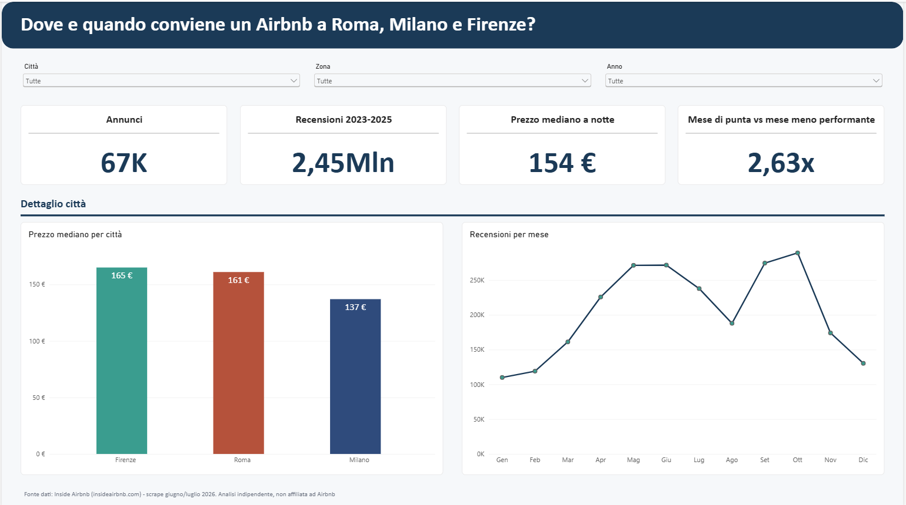
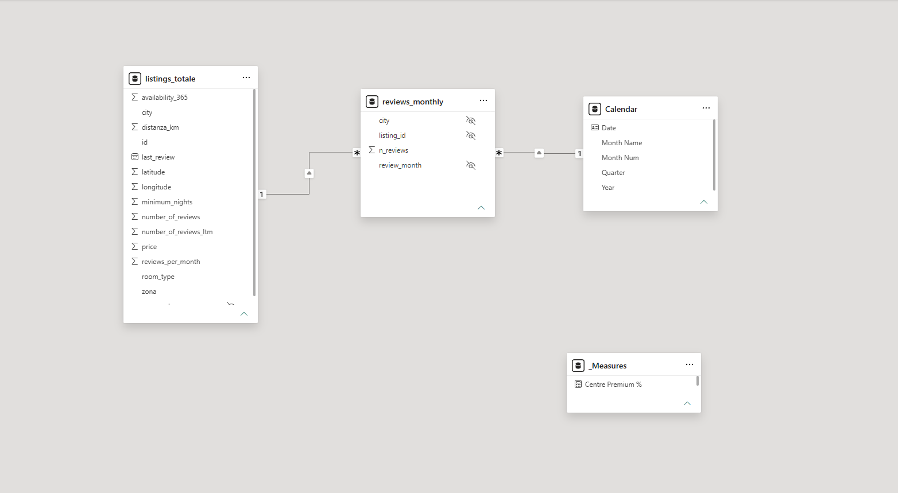
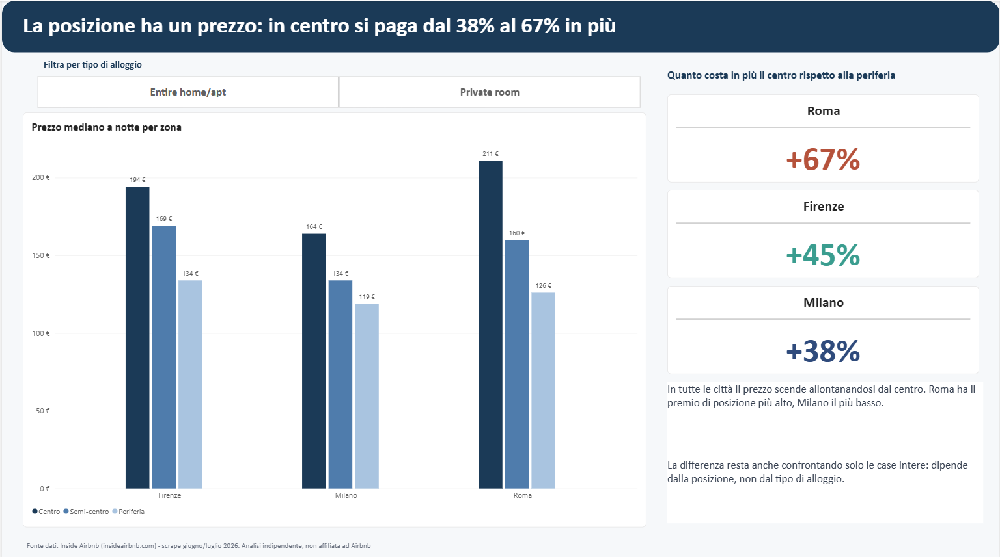
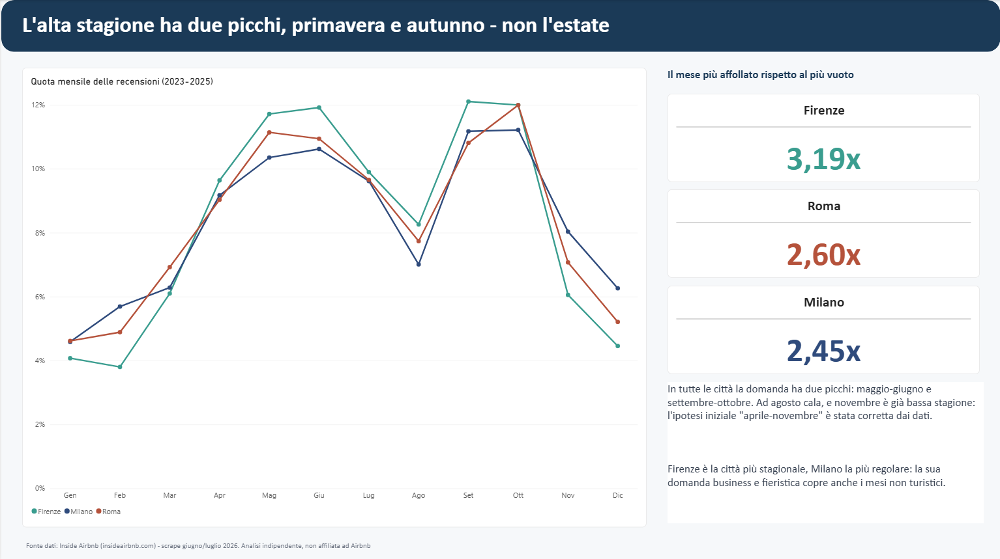
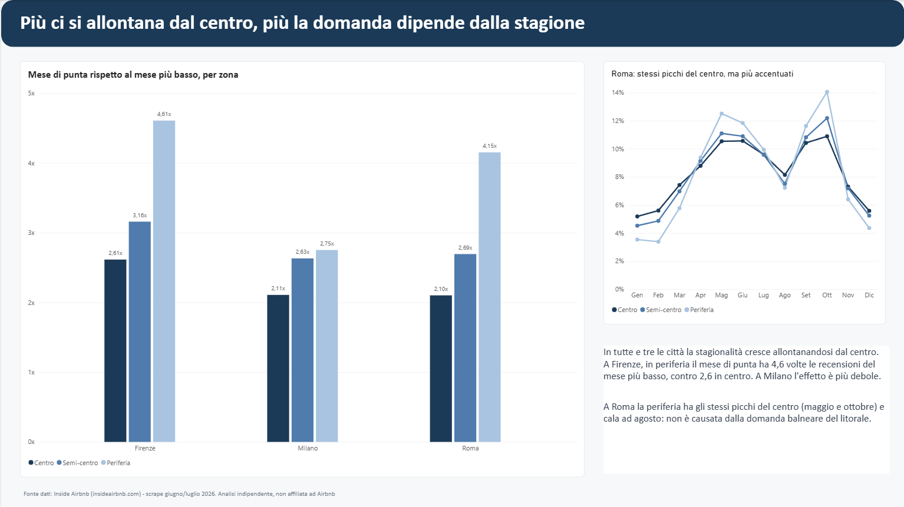
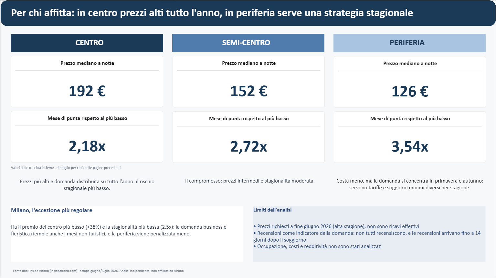

# Airbnb a Roma, Milano e Firenze: dove e quando conviene

Analisi dei prezzi e della stagionalità degli annunci Airbnb in tre città italiane, confrontando **centro, semi-centro e periferia**.

Progetto finale (capstone) del bootcamp **Data Analytics & AI di Epicode**.

**Strumenti:** Excel / Power Query · MySQL · Power BI



🎥 **Video di presentazione (2 min):** [link al video](https://youtu.be/6nYdFk9Oc8U)

---

## La domanda

> Per chi affitta su Airbnb, quanto conta la posizione? E in quali mesi c'è più richiesta?

Prima di guardare i dati ho formulato tre ipotesi:

1. Il prezzo è più alto in centro e scende verso la periferia.
2. L'alta stagione va da aprile a novembre.
3. La periferia dipende dalla stagione più del centro.

---

## I dati

Fonte: **[Inside Airbnb](https://insideairbnb.com)**, progetto indipendente che raccoglie dati pubblici dal sito Airbnb. Dati raccolti a fine giugno / inizio luglio 2026.

| File | Contenuto | Uso nel progetto |
|---|---|---|
| `listings.csv` | Un annuncio per riga: prezzo, posizione, tipo di alloggio | Prezzo per zona |
| `reviews.csv` | Una recensione per riga: annuncio e data | Stagionalità della domanda |
| `calendar.csv` | Disponibilità giorno per giorno | Scartato (vedi sotto) |

**Perché non ho usato il calendario.** Il file `calendar.csv` era la fonte prevista per la stagionalità. Controllandolo, ho visto che non contiene più i prezzi giornalieri e che la disponibilità non distingue i giorni prenotati da quelli bloccati dal proprietario. Ho usato quindi le **recensioni** come indicatore della domanda: ogni recensione corrisponde a un soggiorno avvenuto davvero.

I file originali non sono inclusi nel repository perché troppo pesanti. Si scaricano gratuitamente da Inside Airbnb.

---

## Come ho lavorato

```
CSV Inside Airbnb ──► Power Query (pulizia annunci) ──┐
                                                       ├──► Power BI (modello e report)
CSV recensioni ──► MySQL (caricamento e aggregazione) ─┘
```

### 1. Pulizia degli annunci (Power Query)

- Unione dei tre file `listings.csv` in un'unica tabella: **67.012 annunci**.
- Corretto un errore di lettura del CSV, causato dalle virgolette nei testi.
- Tenuti solo gli affitti brevi, con soggiorno minimo **fino a 30 notti**.
- Esclusi i prezzi anomali con il **metodo IQR**, calcolato città per città (soglie: Firenze 575 €, Milano 439 €, Roma 579 €).
- Calcolata la **distanza dal centro** di ogni annuncio con la formula di Haversine.

### 2. Definizione delle zone

Ho diviso gli annunci di ogni città in **tre gruppi uguali** in base alla distanza dal centro:

| Città | Centro | Semi-centro | Periferia |
|---|---|---|---|
| Firenze | fino a 0,71 km | 0,71 – 1,46 km | oltre 1,46 km |
| Milano | fino a 2,07 km | 2,07 – 3,44 km | oltre 3,44 km |
| Roma | fino a 1,84 km | 1,84 – 3,38 km | oltre 3,38 km |

All'inizio avevo usato le stesse soglie per tutte le città (2 e 5 km). Con quelle soglie la periferia di Firenze era quasi vuota (meno dell'1% delle recensioni), perché Firenze è molto più compatta di Roma. Con soglie calcolate per ogni città, le zone sono confrontabili tra loro.

### 3. Caricamento e aggregazione delle recensioni (MySQL)

- Caricate **4,7 milioni di recensioni** con `LOAD DATA LOCAL INFILE`, senza errori né righe scartate.
- Controlli di qualità: totali per città, date minime e massime, recensioni per anno.
- Tenuti solo gli anni **2023, 2024 e 2025**: il 2020–2021 è falsato dal COVID e il 2026 è incompleto.
- Recensioni raggruppate per annuncio e mese: da 4,7 milioni a **755 mila righe**.

Gli script sono nella cartella [`sql/`](sql/).

### 4. Modello e report (Power BI)

- **Modello a stella:** una tabella dei fatti (recensioni mensili) collegata ad annunci e calendario.
- Analizzato il **96%** delle recensioni, cioè quelle collegate agli annunci rimasti dopo la pulizia.
- Misure principali in DAX:
  - **prezzo mediano**, meno influenzato dai prezzi estremi rispetto alla media;
  - **quota mensile delle recensioni**;
  - **indice di stagionalità**: quante volte il mese più affollato supera il mese più vuoto.



---

## Risultati

### 1. La posizione ha un prezzo ✔ confermata



| Prezzo mediano a notte | Centro | Semi-centro | Periferia | Centro vs periferia |
|---|---|---|---|---|
| Firenze | 194 € | 169 € | 134 € | **+45%** |
| Milano | 164 € | 134 € | 119 € | **+38%** |
| Roma | 211 € | 160 € | 126 € | **+67%** |

In tutte e tre le città il prezzo scende allontanandosi dal centro. La differenza resta quasi uguale confrontando **solo le case intere** (+38%, +35%, +67%): dipende dalla posizione, non dal tipo di alloggio.

### 2. L'alta stagione ha due picchi ↻ corretta dai dati



L'ipotesi iniziale (aprile–novembre) era sbagliata. In tutte le città la domanda ha **due picchi**:

- **maggio – giugno**
- **settembre – ottobre**

In mezzo, **ad agosto c'è un calo**, e **novembre è già bassa stagione**. Il profilo si ripete quasi identico nel 2023, nel 2024 e nel 2025.

### 3. La periferia è più stagionale ✔ confermata



| Indice di stagionalità | Centro | Semi-centro | Periferia |
|---|---|---|---|
| Firenze | 2,61× | 3,16× | **4,61×** |
| Milano | 2,11× | 2,63× | **2,75×** |
| Roma | 2,10× | 2,69× | **4,15×** |

*Esempio: 4,61× significa che a Firenze, in periferia, il mese più affollato ha 4,6 volte le recensioni del mese più vuoto.*

Più ci si allontana dal centro, più la domanda si concentra in pochi mesi. Milano è l'eccezione più regolare, probabilmente grazie a fiere e viaggi di lavoro durante tutto l'anno.

Ho anche controllato se la periferia di Roma fosse influenzata dalla domanda estiva del litorale (Ostia): non è così, perché ha gli stessi picchi del centro e cala anche lei ad agosto.

---

## In pratica, per chi affitta



- **Centro:** prezzi più alti e domanda distribuita su tutto l'anno.
- **Periferia:** prezzi più bassi, ma serve una gestione stagionale (tariffe e soggiorni minimi diversi a seconda del periodo).
- **Milano:** il mercato più regolare, dove la posizione pesa meno.

---

## Limiti dell'analisi

- **I prezzi sono quelli richiesti** a fine giugno 2026, in alta stagione: non sono un prezzo medio annuale né un guadagno reale.
- **Le recensioni indicano la domanda, ma non sono le prenotazioni:** non tutti gli ospiti recensiscono, e la recensione arriva fino a 14 giorni dopo il soggiorno.
- **Mancano gli annunci chiusi:** il file contiene solo le recensioni degli annunci ancora attivi. Per questo confronto la **distribuzione nei mesi** e non il numero totale di recensioni tra un anno e l'altro.
- **Non sono stati analizzati** tasso di occupazione, costi o redditività.

---

## Struttura del repository

```
├── README.md
├── airbnb_dashboard.pbix         # report Power BI
├── progetto_airbnb_3citta.xlsx   # pulizia in Power Query
├── images/                       # screenshot del report
└── sql/
    ├── 01_load_reviews.sql       # caricamento e controlli
    └── 02_analysis.sql           # analisi della stagionalità
```

## Come riprodurre il progetto

1. Scaricare `listings.csv` e `reviews.csv` di Roma, Milano e Firenze da [Inside Airbnb](https://insideairbnb.com/get-the-data/) e metterli in una cartella `raw/`.
2. In MySQL eseguire `sql/01_load_reviews.sql`, dopo aver aggiornato i percorsi dei file.
3. Aprire `airbnb_dashboard.pbix`, aggiornare i percorsi in *Trasforma dati → Impostazioni origine dati* e cliccare **Aggiorna**.

---

*Analisi indipendente, non affiliata ad Airbnb. Dati: Inside Airbnb.*

**Autore:** Francesco · [GitHub](https://github.com/frafanc90)
